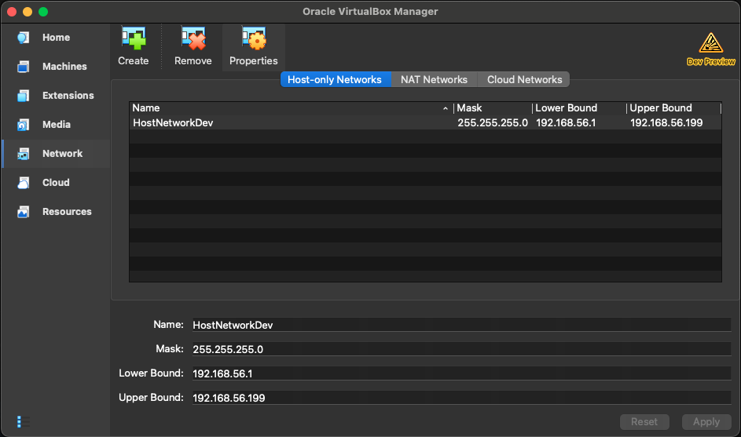
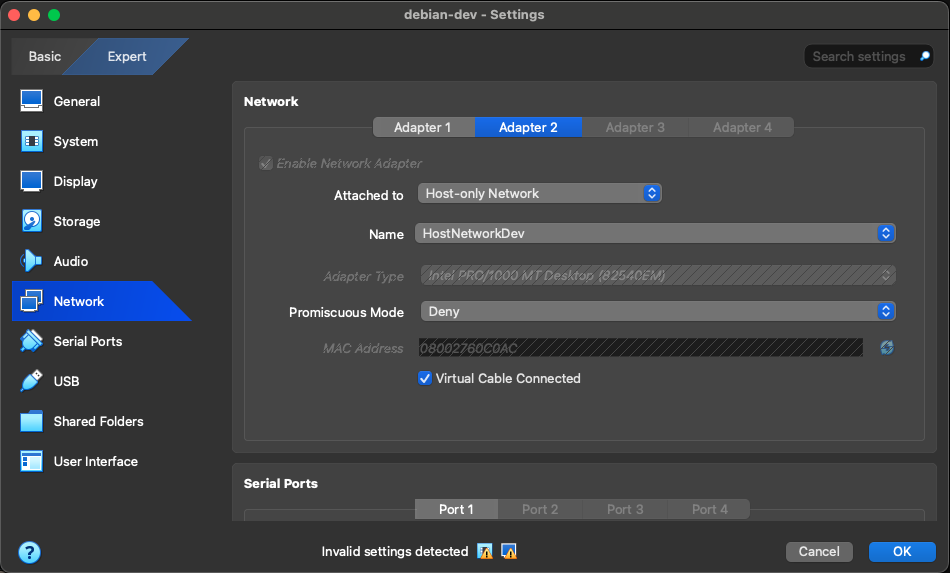

# VirtualBox guest networking

Use **Adapter 1** for internet access and a **host-only Adapter 2** for SSH from the host to the guest.

1. In VirtualBox Manager, open **Network → Host-only Networks** and click **Create**. Note the new network's name (for example, `HostNetworkDev`).

   

2. With the VM powered off, open its **Settings → Network → Adapter 2**. Enable the adapter, set **Attached to** to **Host-only Network**, select the network you created under **Name**, and leave **Virtual Cable Connected** checked. Keep Adapter 1 configured for internet access (for example, NAT).

   

3. Start the guest.

Check interface names with `ip link show` and identify which belongs to each adapter. Replace the example names below if yours differ; do not assume Adapter 2 is always `enp0s9`.

Edit `/etc/network/interfaces` with `sudo nano /etc/network/interfaces`:

```sh
source /etc/network/interfaces.d/*

# The loopback network interface
auto lo
iface lo inet loopback


# Adapter 1: internet (replace with its interface name)
auto enp0s8
iface enp0s8 inet dhcp

# Adapter 2: host-only SSH (replace with its interface name)
auto enp0s9
iface enp0s9 inet dhcp

```

Restart networking and check the links:

```sh
sudo systemctl restart networking
ip link show
# If an adapter is still down:
sudo ip link set enp0s8 up
sudo ip link set enp0s9 up
```

With an SSH server running in the guest, find Adapter 2's IPv4 address (`ip -4 addr show enp0s9`, using its actual interface name). From the host, connect with `ssh <guest-user>@<adapter-2-ip>`. Adapter 1 remains the guest's internet connection.
